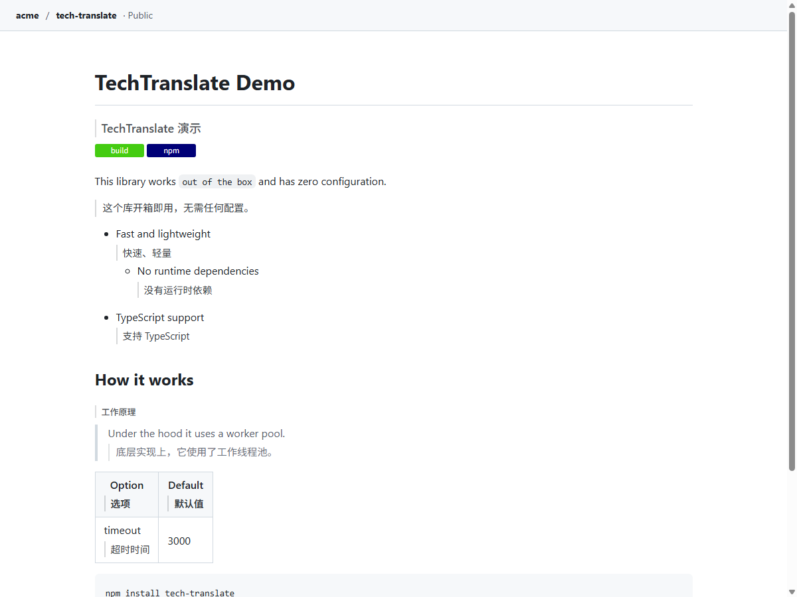
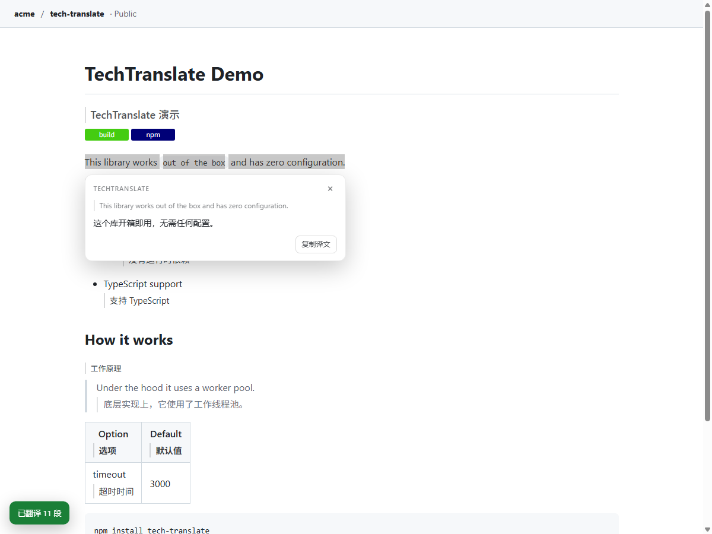
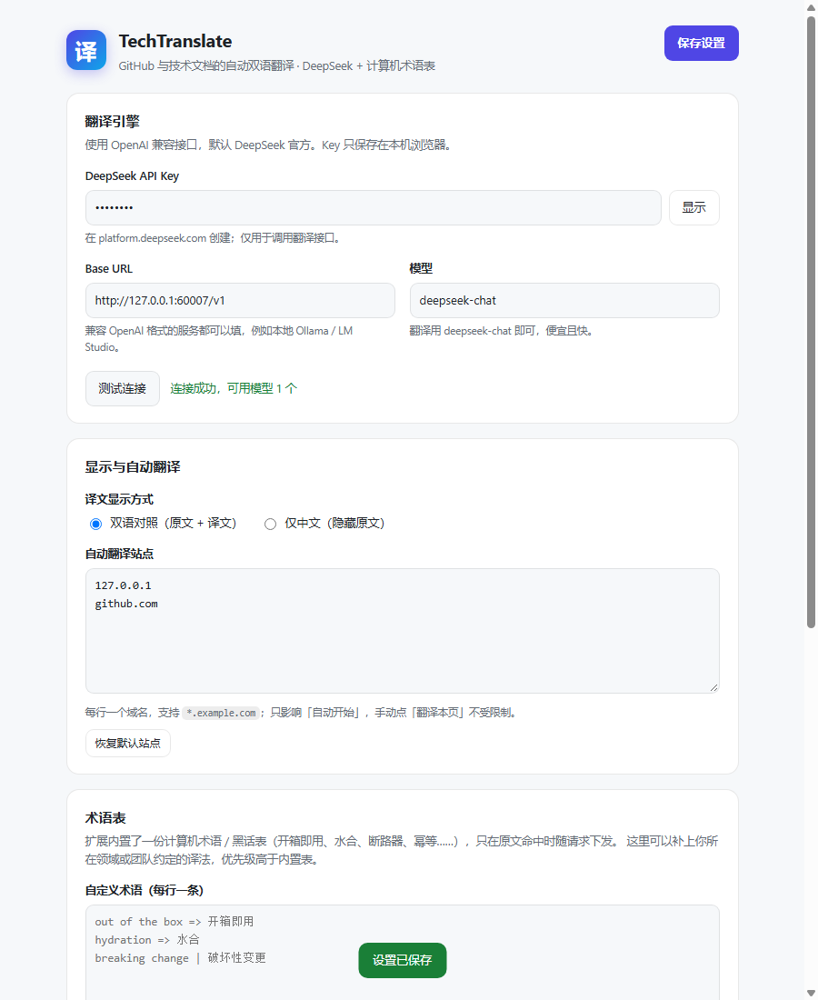

# TechTranslate · 技术文档翻译

[](https://github.com/Anfeng0512/Af-translate/actions/workflows/ci.yml)
[](LICENSE)

给 Chrome / Edge 装一个「懂计算机黑话」的翻译器：打开 GitHub 的 README、issue、PR、wiki，或者英文技术文档，译文会自动贴在原文下方，边生成边显示。代码、命令、路径、变量名保持原样。



## 它和普通网页翻译的区别

- **按语境译术语**：`out of the box` → 开箱即用，`under the hood` → 底层实现上，`hydration` → 水合，`breaking change` → 破坏性变更；内置约 290 条计算机术语 / 黑话，命中才随请求下发。
- **代码零改动**：`<pre>`、行内 `<code>`、命令、路径、URL 不参与翻译；模型也会被要求原样保留标识符。
- **双语对照**：译文单独成块，原文不动；也可以一键切「仅中文」。
- **只翻一次**：按原文哈希做本地缓存，刷新同一页、重复出现的表头都不会再花 token。
- **流式渲染**：按段落分批请求，先翻完的段落先显示，不用等整页。



## 安装

### 方式一：下载 Release（推荐给使用者）

1. 打开仓库右侧的 **Releases**，下载最新的 `tech-translate-*.zip`
2. 解压到一个固定目录（不要放在临时文件夹，扩展会记住这个路径）
3. Chrome 打开 `chrome://extensions`，右上角开启 **开发者模式**
4. 点 **加载已解压的扩展程序**，选择解压后含 `manifest.json` 的目录
5. Edge 用 `edge://extensions`，步骤相同

### 方式二：直接用仓库源码（推荐给开发者）

1. `git clone` 本仓库
2. `chrome://extensions` → 开发者模式 → 加载已解压的扩展程序 → 选择仓库根目录
3. 改完代码后点扩展卡片上的刷新按钮即可，无需构建

要求 Chrome / Edge 116+；跑 E2E 测试需要 137+。

### 可选：本地 .md 文件

想翻译本地 `.md` 文件（`file://`）的话，在扩展详情里打开 **允许访问文件网址**。

## 首次配置

点扩展图标 → **设置与术语表**：

| 项 | 填什么 |
|---|---|
| DeepSeek API Key | 在 [platform.deepseek.com](https://platform.deepseek.com) 创建，形如 `sk-...` |
| Base URL | 默认 `https://api.deepseek.com`，不用改 |
| 模型 | `deepseek-chat`（翻译够用且便宜） |

点 **测试连接**，通过后 **保存设置**，再回到弹窗把总开关打开。

### 用本机 Ollama（可选，零费用）

Ollama 默认只接受网页来源，会直接拒绝扩展发起的请求（HTTP 403，空响应），所以启动时要放开来源：

```powershell
# 1) 先完全退出 Ollama（托盘图标 → Quit），确认没有残留进程
Get-Process ollama* -ErrorAction SilentlyContinue | Stop-Process

# 2) 允许扩展来源后再启动
$env:OLLAMA_ORIGINS="*"
ollama serve

# 想永久生效（关掉终端也有效，之后从托盘启动即可）
setx OLLAMA_ORIGINS "*"
```

设置页填：

| 项 | 值 |
|---|---|
| Base URL | `http://127.0.0.1:11434/v1`（必须带 `/v1`） |
| 模型 | `ollama list` 里的名字，如 `qwen3:8b` |
| API Key | 随便一个非空值，如 `ollama` |

> 翻译任务建议用通用指令模型（`qwen3:8b`、`qwen2.5:7b-instruct`），RP / 角色扮演微调模型容易加戏。



## 使用

- **自动翻译**：命中「自动翻译站点」列表（默认 GitHub、Gist、GitLab、MDN、Python 文档、React、Node、Go、Rust、Kubernetes、Docker、npm、PyPI、Stack Overflow）时，页面打开约 1 秒后自动开始。
- **手动翻译**：弹窗点「翻译本页」，或按 `Alt+T`；再按一次还原。
- **翻译选中文字**：选中文字 → 右键 → 「翻译选中文字」，选区旁弹出译文卡片，可复制。
- **显示模式**：双语对照 / 仅中文，弹窗或设置页切换。
- **当前站点不在列表**：弹窗里点「把 xxx 加入自动翻译」即可。

## 术语表

内置术语表覆盖常见工程黑话、Git/GitHub 用语、前后端/数据库/网络/容器，以及 AI 训练与推理（微调、量化、显存、RAG……）。

可以补充自己团队约定的译法，设置页「术语表」每行一条，三种分隔符都行：

```text
out of the box => 开箱即用
hydration = 水合
breaking change | 破坏性变更
# 这一行会被忽略
```

命中的自定义术语会排在内置术语之前，优先生效。

## 隐私与费用

- API Key 只存在本机浏览器的 `chrome.storage.local`，只发送到你在设置里填写的接口。
- 只有「准备翻译的正文片段」会发出去；代码块、页面导航、浏览记录都不发送。
- 缓存键是原文的哈希，缓存内容是译文，存在本机。
- 费用由接口按 token 计费。DeepSeek 的价格下，一页 README 通常是几分钱；命中缓存不重复计费。
- 扩展本身不收集任何数据，没有远程统计。

## 已知限制

- Chrome 内置 PDF 阅读器、`chrome://` 页面、应用商店页面无法注入翻译。
- 只翻正文：GitHub 的按钮、导航、侧栏保持英文（这是刻意的，避免界面混乱）。
- 少数字体/框架特殊的站点可能漏块；可以选中文字右键翻译兜底。
- 「仅中文」模式会连 GitHub 标题锚点一起隐藏，复制链接时注意。
- 同一段文字在不同仓库语境不同，但缓存复用同一条译文；想强制重翻可清空缓存。

## 开发与测试

```powershell
# 单元测试（标记解析、术语表、提示词）
node test/unit.test.mjs

# 端到端：真实 headless Chrome + 本地 mock 翻译接口
node test/e2e.mjs
```

E2E 覆盖：扩展加载 → 写入设置 → 自动翻译 → 流式渲染 → 双语/仅中文 → 还原 → 缓存命中（不再发请求）→ 选中翻译 → 设置页测试连接与保存 → 弹窗初始化。产物截图在 `test/artifacts/`。

> Chrome 137+ 已禁用 `--load-extension`，所以测试改用 CDP 的 `Extensions.loadUnpacked`（需要 `--enable-unsafe-extension-debugging`），在 headless 下真实加载扩展。测试需要启动本机 Chrome，建议在不受限的终端里跑。

## 目录结构

```text
tech-translate/
├── manifest.json          # MV3 清单
├── icons/                 # 16/32/48/128 图标
├── src/
│   ├── background.js      # Service Worker：分批、缓存、重试、右键菜单
│   ├── settings.js        # 默认设置与读写
│   ├── glossary.js        # 计算机术语表
│   ├── prompt.js          # 提示词与术语命中
│   ├── markers.js         # ⟦id⟧ 流式分片解析
│   ├── cache.js           # 译文缓存与清理
│   ├── llm.js             # OpenAI 兼容流式请求
│   ├── content/           # 正文识别、双语渲染、SPA 跟随、选卡
│   ├── popup/             # 工具栏弹窗
│   └── options/           # 设置页
├── test/                  # 单元测试、mock 接口、Chrome E2E
├── tools/make-icons.py    # 图标生成
└── docs/                  # 截图
```

## 参与贡献

项目刻意保持「零构建、零运行时依赖」：改完源码在 `chrome://extensions` 点刷新就生效。提交前请跑：

```powershell
node test/unit.test.mjs
node test/e2e.mjs
```

详细约定（分支、提交信息、新增站点适配）见 [CONTRIBUTING.md](CONTRIBUTING.md)。

## 发布新版本（维护者）

```powershell
# 1) 改 manifest.json / package.json / CHANGELOG.md 的版本号
# 2) 提交后打 tag，推 tag 会自动触发 .github/workflows/release.yml
git tag v1.0.2
git push origin v1.0.2
```

GitHub Actions 会把 `manifest.json + src + icons + docs + README + LICENSE` 打成 zip，挂到对应的 Release 下。

## 更新日志

见 [CHANGELOG.md](CHANGELOG.md)。

## 排查

| 现象 | 处理 |
|---|---|
| 提示 `401` | API Key 填错或过期，设置页「测试连接」复测 |
| 提示 `429` | 请求太密，设置页把并发调到 1–2 |
| 页面没反应 | 总开关是否打开；站点是否在自动列表；刷新一次页面 |
| 提示「没有配置 API Key」 | 设置页填写并保存；扩展需要刷新页面后才读新设置 |
| 译文没出现但页面上有原文 | 该段可能被判为中文/代码而跳过；可选中右键翻译验证 |
| 本地 Ollama 报「拒绝了扩展来源 / 403」 | 退出 Ollama，按上文 `OLLAMA_ORIGINS=*` 重新启动；Base URL 确认带 `/v1` |
| 本地 Ollama 报「连不上」 | `ollama serve` 没跑，或端口不是 11434；`curl http://127.0.0.1:11434/api/version` 自检 |
| 想换成本地模型 | Base URL 填 Ollama 的 `/v1` 地址，模型名填本地模型；不需要真 Key，随便填一个非空值 |

## License

MIT


